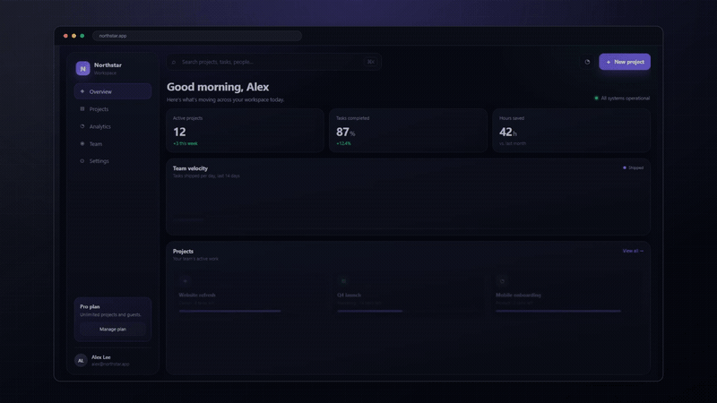
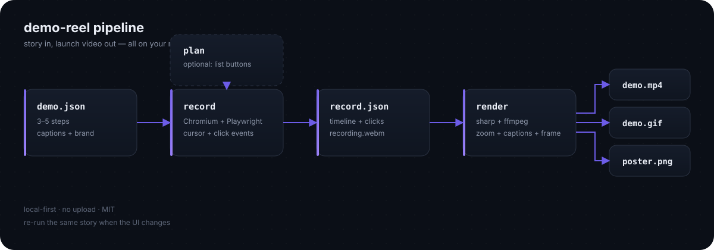

# demo-reel

[](LICENSE)
[](package.json)
[](package.json)
[](SKILL.md)
[](https://github.com/yanjiangfan/demo-reel/stargazers)

**Give it a URL. Get a polished demo video and GIF.**



[Watch the 12s MP4](docs/hero.mp4) · [Install](#install) · [How it works](#how-it-works) · [Roadmap](#roadmap)

demo-reel is an agent skill that records your product in a real browser, zooms
into every click, adds a cursor, captions, a browser frame and a background,
then renders a launch-ready MP4 + GIF.

No timeline editing. No screen-studio subscription. One command.

> Works with Claude Code, Codex, Cursor and any agent that supports
> [Agent Skills](https://agentskills.io).

---

## Why

Every launch needs a demo:

- a GIF at the top of the README
- a hero video on the landing page
- a clip for X, LinkedIn, Product Hunt
- a walkthrough for onboarding

Recording one by hand takes 1–3 hours and still looks like a screen recording.
demo-reel turns it into a repeatable command. Change the UI, re-run it, get a
fresh demo.

**What you get**

- 1080p MP4 + GIF + poster
- automatic zoom into each click
- a visible cursor and click ripple
- benefit-driven captions
- a browser frame and a generated background
- a `record.json` timeline you can re-render without recording again
- everything runs locally — no upload, no cloud

## Install

As an agent skill:

```bash
npx skills add yanjiangfan/demo-reel
```

From source:

```bash
git clone https://github.com/yanjiangfan/demo-reel
cd demo-reel
npm install
npx playwright install chromium
node bin/demo-reel.mjs doctor
```

Requirements: Node 20+. ffmpeg and ffprobe come from npm packages; no system
install needed.

## Quickstart

```bash
# 1. Check the environment
node bin/demo-reel.mjs doctor

# 2. See it work on the bundled demo app
node bin/demo-reel.mjs demo

# 3. Use it on your own app
node bin/demo-reel.mjs plan --url https://your-app.com
node bin/demo-reel.mjs record --config demo.json
node bin/demo-reel.mjs render --config demo/record.json
```

Output:

```
demo/
  demo-16x9.mp4
  demo.gif
  poster.png
  record.json
```

## The story file

```json
{
  "url": "https://your-app.com",
  "displayUrl": "your-app.com",
  "viewport": { "width": 1440, "height": 810 },
  "brand": { "background": "#070a12", "accent": "#6c5ce7" },
  "steps": [
    { "action": "wait", "ms": 600 },
    {
      "action": "click",
      "text": "New project",
      "pause": 600,
      "zoom": false,
      "caption": "Start in one click"
    },
    { "action": "wait", "ms": 900 },
    {
      "action": "type",
      "selector": "input[name=project-name]",
      "value": "Q4 Launch",
      "pause": 350,
      "caption": "Give it a name"
    },
    { "action": "wait", "ms": 900 },
    {
      "action": "click",
      "text": "Create project",
      "pause": 900,
      "zoom": false,
      "caption": "Your workspace is ready"
    }
  ]
}
```

Actions: `wait`, `goto`, `click`, `type`, `hover`, `scroll`, `press`, `waitFor`,
`screenshot`.

Locators, in order of preference:

1. `text` — visible label
2. `role` + `name` — accessible role
3. `selector` — CSS, only when needed

Tips:

- 3–5 steps, 12–25 seconds.
- Add a short `wait` after an action so the result and caption can land.
- Use `"zoom": false` when the interesting result is elsewhere on screen.
- Captions state the benefit, not the UI label.

## Commands

| Command | What it does |
|---|---|
| `demo-reel doctor` | Check Node, Chromium, ffmpeg, fonts |
| `demo-reel plan --url <url>` | Screenshot + list interactive elements |
| `demo-reel record --config demo.json` | Record the story |
| `demo-reel render --config demo/record.json` | Render MP4 + GIF |
| `demo-reel serve` | Serve the bundled demo app |
| `demo-reel demo` | Record + render the bundled demo |

Useful flags:

```bash
--login                 # open a visible browser, log in once
--storage-state auth.json
--proxy http://127.0.0.1:10808
--viewport 1440x810
--headed                # watch the recording happen
--no-gif
--no-captions
--zoom 1.28
```

## Login and protected pages

```bash
node bin/demo-reel.mjs record --config demo.json --login
```

A visible browser opens. Log in manually. The session is saved to `auth.json`
locally and reused. demo-reel never asks for your password and never uploads
cookies.

## How it works



1. `plan` opens the page and inventories buttons, links and inputs.
2. `record` drives Chromium, moves the cursor, clicks, types and records.
3. Click timestamps become zoom keyframes.
4. `render` crops around each click, adds captions, a browser frame and a
   background, then encodes MP4 + GIF with ffmpeg.

Because it drives a real browser, it works with React, Vue, Svelte, plain HTML,
SPAs and authenticated pages.

## Examples

| Example | Story | Output |
|---|---|---|
| Northstar SaaS dashboard | [examples/story.json](examples/story.json) | [MP4](docs/hero.mp4) · [GIF](docs/hero.gif) |

## When a site cannot be recorded

Some sites use captchas, aggressive anti-bot checks, or canvas-only UI. In that
case, record the flow manually and use the recording as the source. (Direct
video input is on the roadmap.)

## Why not Screen Studio?

Different tools:

| | Screen Studio | demo-reel |
|---|---|---|
| Workflow | manual editing | a story file + one command |
| Repeatable | no | yes |
| Runs in CI | no | yes |
| Price | paid | free, MIT |

Use Screen Studio when you want frame-by-frame control. Use demo-reel when you
want a repeatable launch asset and a timeline you can commit.

## FAQ

**Is this a screen recorder?**
No. It is a repeatable pipeline: a story file + a browser + a renderer. The
recording is a side effect.

**Does it work on Windows?**
Yes. It is developed on Windows and uses npm-bundled ffmpeg binaries.

**Do I need an AI agent to use it?**
No. The CLI works standalone. The agent skill is a convenience: it can inspect
the page, write the story and run the commands for you.

**Can I record a site I don't own?**
Only with permission. Do not use it to scrape, bypass paywalls or evade
anti-bot systems.

**Can I use the output commercially?**
Yes. The code is MIT. Make sure the page you record and the fonts/assets in it
are yours or licensed.

## Roadmap

- [ ] 9:16 vertical export
- [ ] Screen-recording input (auto-zoom + captions on existing footage)
- [ ] Voiceover (TTS)
- [ ] Device frames (iPhone, Android, macOS)
- [ ] Brand presets
- [ ] Cloud rendering

## Contributing

Issues and PRs are welcome. Start with [CONTRIBUTING.md](CONTRIBUTING.md).
Please do not commit `auth.json`, customer recordings or anything that contains
personal data.

## License

MIT — see [LICENSE](LICENSE).

---

If this saved you an afternoon, a star helps more people find it.
