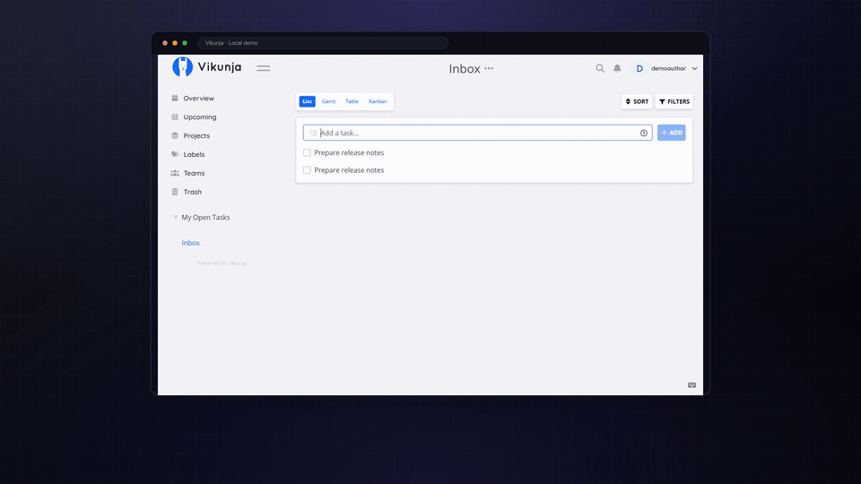
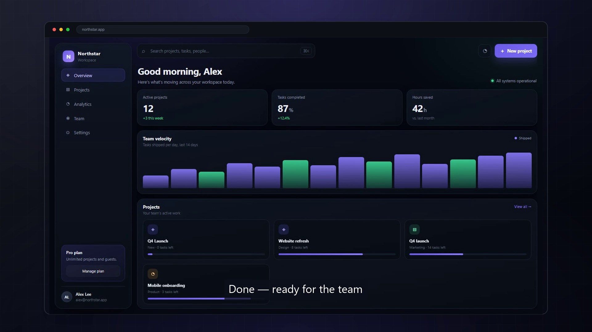
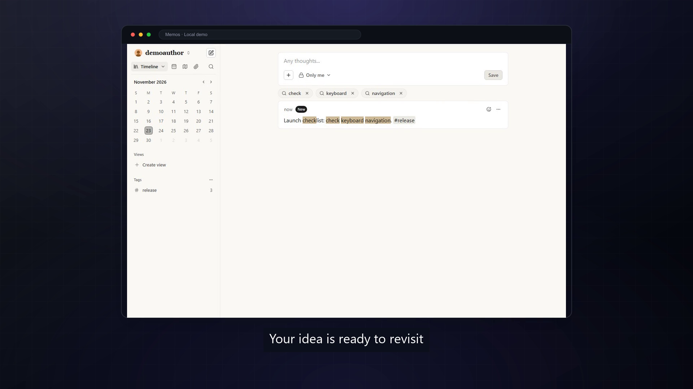
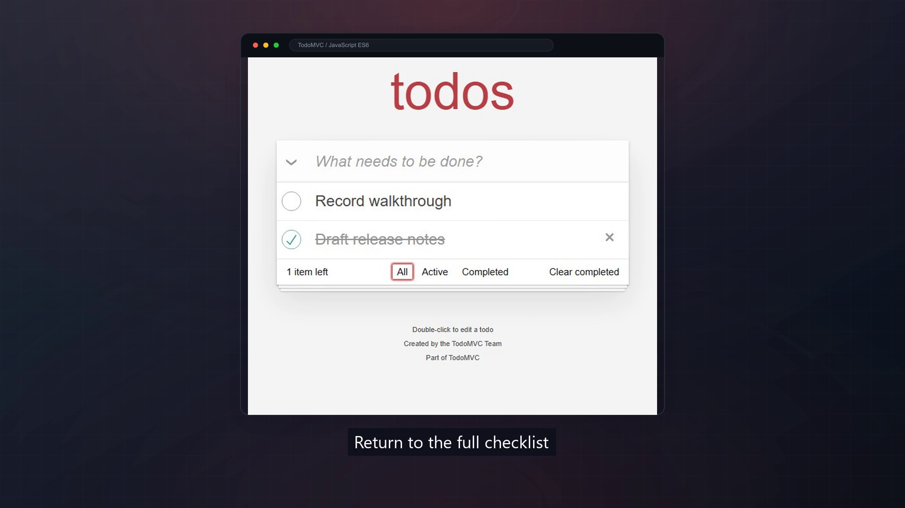
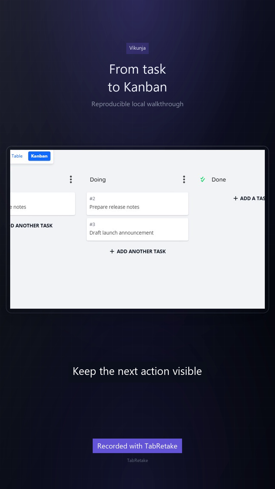
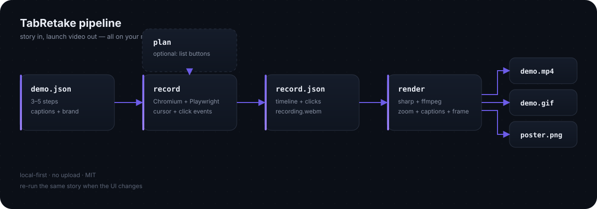

# TabRetake — repeatable web app demo videos

English · [简体中文](README.zh-CN.md)

[](LICENSE)
[](package.json)
[](https://github.com/gnawbit/tabretake/releases/latest)
[](SKILL.md)
[](https://github.com/gnawbit/tabretake/stargazers)

**Automate your web app demos. Never manually record and edit a screen again.**

Turn editable JSON steps or AI Agent instructions into crisp **16:9 README GIFs** and **9:16 portrait launch videos** — complete with smooth click zooms, cursor ripples, and unoccluded bottom captions. When your UI changes, re-run with one command.



*Recorded on [Vikunja v2.8.0](https://github.com/go-vikunja/vikunja) (15k★ open-source Kanban): Type a task, drag it into Doing on a live board, and automatically focus on the result. Generates 16:9 MP4, README GIF and 9:16 portrait video in seconds.*

[Project page](https://gnawbit.github.io/tabretake/) · [Watch the demo](docs/hero.mp4) · [Install](#install) · [How it works](#how-it-works) · [Real Showcase](#-real-world-showcase-proven-on-production-open-source-apps) · [Roadmap](#roadmap)

### 📊 Technical Specs at a Glance

| Spec | Value |
|---|---|
| **Runtime & License** | Node.js `>=20.9.0`, MIT License, 100% local execution (zero cloud upload, zero telemetry) |
| **Browser Engine** | Playwright Chromium with automatic fallback to local **Chrome / Edge** (`--browser auto`) |
| **Input Modes** | (1) Live Web URL + editable JSON steps (`init --auto`) · (2) Existing MP4/WebM recording + JSON `marks` |
| **Output Artifacts** | `16:9` 1080p MP4, `README GIF` (~400–900 KB), `9:16` portrait MP4/GIF, PNG posters, `record.json` |
| **Theme Presets** | `midnight` (dark studio), `daylight` (light minimal), `paper` (warm cream), `slate` (slate-emerald) |
| **Platforms & Agents** | Windows, macOS, Linux · Claude Code, Codex, Cursor, and any [Agent Skills](https://agentskills.io) client |

### ⚡ Why TabRetake vs Traditional Screen Recording?

| Challenge | Traditional Screen Recording | TabRetake Automated Workflow |
|---|---|---|
| **UI Changes** | Re-record manually, re-edit, re-export (2+ hours) | Edit 1 line of JSON or ask your agent (`tabretake render`, 10s) |
| **Mobile (9:16)** | Clunky manual cropping or separate recording | Simultaneous 16:9 + 9:16 export with independent focus zoom |
| **Captions** | Text overlays obstructing interactive UI elements | Dedicated bottom caption band fitted to source aspect ratio |
| **Automation** | Purely manual busywork | Headless Playwright CLI + AI Coding Agents (Claude Code, Cursor, Codex) |

Keep the story with your code and re-run it when the UI changes.
Already have a screen recording? Supply timestamp marks to
[render the same outputs without browser automation](#use-an-existing-screen-recording).

### 🚀 Quick Taste (Zero-Wait with Local Chrome/Edge)

```bash
npm install --global @gnawbit/tabretake@0.4.2
tabretake demo --preset daylight
```

> Already have Chrome or Edge installed? `tabretake demo` works immediately without waiting for a separate browser download. Run `tabretake setup` anytime if you want Playwright's pinned Chromium.

### 🎯 Real-World Showcase: Proven on Production Open-Source Apps

No synthetic AI mockups. TabRetake is verified against real-world, complex DOMs and interactive components:

| 📋 [Vikunja](https://gnawbit.github.io/tabretake/vikunja/) (15k★ Kanban) | ✍️ [Memos](https://gnawbit.github.io/tabretake/memos/) (35k★ Notes) | 📝 [TodoMVC](https://gnawbit.github.io/tabretake/todomvc/) (Web Benchmark) |
|:---:|:---:|:---:|
| <a href="https://gnawbit.github.io/tabretake/vikunja/"></a> | <a href="https://gnawbit.github.io/tabretake/memos/"></a> | <a href="https://gnawbit.github.io/tabretake/todomvc/"></a> |
| **Kanban Drag & Drop**<br>Card movement & destination focus | **Rich Text & Search**<br>Live contenteditable & tag search | **Standard Task Filtering**<br>Clean ES6 multi-state walkthrough |
| [Story JSON](site/vikunja/story.json) · [Recipe](https://gnawbit.github.io/tabretake/vikunja/) | [Story JSON](site/memos/story.json) · [Recipe](https://gnawbit.github.io/tabretake/memos/) | [Story JSON](site/todomvc/story.json) · [Recipe](https://gnawbit.github.io/tabretake/todomvc/) |

> Works locally on Windows, macOS and Linux. Supports Claude Code, Codex, Cursor and any agent that supports [Agent Skills](https://agentskills.io).

---

## Why

Every launch needs a demo:

- a GIF at the top of the README
- a hero video on the landing page
- a clip for product launches and social sharing
- a walkthrough for onboarding

Keep these assets reproducible with a story file that you or your agent can
edit and run again after a release.

**What you get**

- 1080p MP4 + GIF + poster, in **16:9 and 9:16**
- automatic zoom into each click
- a visible cursor and click ripple
- benefit-driven captions
- a browser frame and a generated background
- a `record.json` timeline you can re-render without recording again
- everything runs locally — no upload, no cloud

### Formats

| 16:9 — README / landing page | 9:16 — portrait launch video |
|---|---|
|  |  |

[16:9 MP4](docs/hero.mp4) · [9:16 MP4](docs/hero-9x16.mp4) · [9:16 GIF](docs/hero-9x16.gif)

## Install

Install the CLI from npm.

```bash
npm install --global @gnawbit/tabretake@0.4.2
tabretake demo
```

Requires Node 20.9+. Run `tabretake` from your working directory;
the bundled demo writes its output to `./demo`. If Playwright Chromium is not
installed, TabRetake automatically falls back to local Chrome or Edge
(`--browser auto`). Run `tabretake setup` (or `tabretake setup --with-deps` on Linux)
to install Playwright's pinned Chromium. ffmpeg and ffprobe are included as dependencies.

The npm package is [`@gnawbit/tabretake`](https://www.npmjs.com/package/@gnawbit/tabretake).
For legacy release notes (`v0.4.0` and earlier / `demo-reel`), see [compatibility](docs/compatibility.md).

For development, install from a checkout:

```bash
git clone https://github.com/gnawbit/tabretake
cd tabretake
npm ci
node bin/tabretake.mjs doctor
```

The examples below use the source checkout. With the global installation,
replace `node bin/tabretake.mjs` with `tabretake`.

To add the agent workflow after setting up the CLI:

```bash
npx skills@1.9.0 add "https://github.com/gnawbit/tabretake.git#v0.4.2" --skill tabretake
```

Run this in the target project; add `--agent codex`, `--agent claude-code` or
`--agent cursor` to select a client. Skills CLI 1.9.0 needs Node 22.20+, while
TabRetake itself needs Node 20.9+. Tell your agent whether to use the global CLI
or a source checkout. Install the CLI and Skill from the same revision.

Claude Code users can install the plugin instead (CLI 2.1.292+):

```bash
claude plugin install tabretake --marketplace "gnawbit/tabretake#v0.4.2"
```

Install the workflow through one of these routes; the plugin still needs the
TabRetake runtime installed above. It is a Claude Code plugin, not a Cowork
package or an MCP server. [Discovery checks and their limits](docs/agent-discovery.md)
document what has actually been verified.
Example requests:

- "Make a README GIF showing the signup flow at http://localhost:3000."
- "Create a portrait launch demo from my web app, with captions."
- "Regenerate the product walkthrough after these UI changes."

The agent plans a story and runs the CLI. For an existing recording, supply
the video and the moments to highlight instead.

## Quickstart

```bash
# 1. Check the environment
node bin/tabretake.mjs doctor

# 2. See it work on the bundled demo app
node bin/tabretake.mjs demo

# 3. Use it on your own app (Auto-detect interactive steps + theme preset)
tabretake init --url https://your-app.com --auto --preset daylight
tabretake record --config demo.json
tabretake render --config demo/record.json --vertical
```

`init --auto` scans your target page, detects visible inputs and buttons, and generates a runnable multi-step story with captions.
Without `--auto`, `init` creates a minimal starter waiting on the page. Use `plan --url <url>` to inventory all available DOM controls (including ARIA/HTML `label` and native select `options`).
`name` remains the HTML attribute and `selector` is the suggested CSS locator; this is a DOM inventory rather than a full accessibility tree.

```bash
node bin/tabretake.mjs record --config demo.json
node bin/tabretake.mjs render --config demo/record.json --vertical
```

Output:

```
demo/
  demo-16x9.mp4
  demo-9x16.mp4
  demo.gif
  demo-9x16.gif
  poster.png
  poster-9x16.png
  record.json
```

## The story file

### Preview and focus

Run `tabretake preview --config demo.json` to execute the story in a visible
browser before recording. Preview performs the actual clicks and edits against
your app. Use disposable demo data and reset it before recording. It reports
each step, preserves existing recordings, and writes only explicit `screenshot`
steps. Add `--headless --json` for automation and `--storage-state auth.json`
for authenticated flows.

After an action reveals a result, wait for it and focus the camera on it.
The target is measured after scrolling into view. A focus step holds that
position for its `pause`; add another focus step after subsequent layout changes.

```json
[
  { "action": "waitFor", "selector": "#result" },
  { "action": "focus", "selector": "#result", "caption": "Ready to share", "pause": 1200 }
]
```

Preview checks browser actions. Use a rendered clip to check zooms and captions.

```json
{
  "url": "https://your-app.com",
  "displayUrl": "your-app.com",
  "viewport": { "width": 1440, "height": 810 },
  "brand": { "background": "#070a12", "accent": "#6c5ce7" },
  "steps": [
    { "action": "wait", "ms": 600 },
    {
      "action": "click",
      "text": "New project",
      "pause": 600,
      "zoom": false,
      "caption": "Start in one click"
    },
    { "action": "wait", "ms": 900 },
    {
      "action": "type",
      "selector": "input[name=project-name]",
      "value": "Q4 Launch",
      "pause": 350,
      "caption": "Give it a name"
    },
    { "action": "wait", "ms": 900 },
    {
      "action": "click",
      "text": "Create project",
      "pause": 900,
      "zoom": false,
      "caption": "Your workspace is ready"
    }
  ]
}
```

Actions: `wait`, `goto`, `click`, `type`, `hover`, `focus`, `drag`, `scroll`, `press`,
`waitFor`, `screenshot`.

`click` waits for an enabled, unobstructed target up to `timeout` (milliseconds, default 20,000; blocked clicks return `STEP_TIMEOUT`).

Locator fields are `selector`, `role` + `name` (or `text`), `name`, or `text`.
An explicit `selector` is tried first. Label matching tries exact buttons/links,
then partial buttons/links, then plain text (exact before partial). An explicit
`role` restricts matching to that role, with exact names first. Each candidate
keeps the first visible match; use a scoped selector when labels repeat or overlap.
See [compatibility](docs/compatibility.md) for legacy matching behavior.

Tips:

- 3–5 steps, 12–25 seconds.
- Add a short `wait` after an action so the result and caption can land.
- Use `"zoom": false` when the interesting result is elsewhere on screen.
- Captions state the benefit, not the UI label.

Captions wrap to fit the frame and shrink modestly when needed.
If a caption cannot fit at a readable size, rendering asks you to shorten it
or split it across steps. A new caption replaces the previous one immediately.

### Camera movement

Click zooms ease between targets over 0.35 seconds. Set top-level
`"zoomDuration": 0.5` in a story or marks config, or override it with
`render --config demo/record.json --zoom-duration 0.5`. Use `0` for immediate
cuts and `"zoom": false` on a step to return to the full view. Rapid clicks
continue from the current camera position.

### Posters

Posters use a frame near the end to show the result. Set `"posterAt": 4.5`
at the top level of a story or recording-marks config to choose another frame.
For an existing timeline, `render --config demo/record.json --poster-at 4.5`
overrides that setting without recording again. Times are seconds into the
trimmed output, starting at zero, and must be shorter than the video.

### Theme presets & vertical branding

Choose a built-in `brand.preset` (`midnight`, `daylight`, `paper`, or `slate`) in your config or override it at render time with `--preset <name>`. Explicit `brand.background` and `brand.accent` override preset colors unless `--preset` is passed on the CLI.

```json
"brand": {
  "preset": "daylight"
},
"vertical": {
  "badge": "Your product",
  "titleLines": ["Ship faster", "without the busywork"],
  "subtitle": "Native · Local · Private",
  "cta": "your-app.com",
  "watermark": false
}
```

`titleLines` is capped at two lines. `watermark: false` removes the small
TabRetake mark. Chinese text automatically uses a CJK font.

Both 16:9 landscape and 9:16 portrait outputs fit the source video's aspect ratio
and reserve dedicated space below the content for captions. For a mobile flow,
inspect with `plan --viewport 390x844`, then record at the same viewport.
Use `--vertical --zoom 1 --vertical-zoom 1.8` to keep landscape overview while
enlarging portrait focus targets (`vertical.zoom` saves it in config; the CLI flag
takes precedence). Steps with `zoom: false` keep the full view. Review the result
for cropped context.

## Commands

| Command | What it does |
|---|---|
| `tabretake --version` | Print the installed CLI version |
| `tabretake capabilities --json` | List supported commands, flags and JSON support |
| `tabretake doctor [--json]` | Check Node, Chromium, ffmpeg, fonts |
| `tabretake setup` | Install the Chromium version used by this CLI |
| `tabretake init --url <url> [--auto] [--preset <name>]` | Create an editable story file (`--auto` scans controls; `--preset` sets theme) |
| `tabretake validate --config demo.json [--json]` | Validate a story, marks or recorded timeline without recording |
| `tabretake plan --url <url>` | Screenshot + list interactive elements |
| `tabretake record --config demo.json` | Record the story |
| `tabretake preview --config demo.json` | Execute steps in a visible browser before recording |
| `tabretake render --config demo/record.json [--preset <name>]` | Render MP4 + GIF |
| `tabretake serve` | Serve the bundled demo app |
| `tabretake demo [--preset <name>]` | Record + render the bundled demo |

### 🏷️ Project Badge

If your repository uses TabRetake to generate its release walkthroughs or README GIFs, you can add our badge:

```markdown
[](https://github.com/gnawbit/tabretake)
```

For agents, `capabilities --json` and `doctor --json` emit one JSON object on
stdout with `schemaVersion: 1` and the installed version. Diagnostic checks have
stable `id`, `required`, `status` and recovery `hint` fields on failure. Exit code
`1` means a required check failed; missing caption fonts are warnings (exit `0`
if required checks pass). Browser presence is checked without launching a window.

`doctor` checks the whole toolkit. Rendering an existing recording or saved
timeline does not need a browser: if `chromium` is the only failed required
check, skip browser setup and continue with `validate` and `render`; fix other
required errors first. Browser planning and recording require Chromium or local Chrome/Edge.

Before recording, run `validate --config demo.json --json` against the packaged
[JSON Schema](schemas/story.schema.json) (`record` and `render` also validate before writing outputs).
For editor completion, add `"$schema": "https://raw.githubusercontent.com/gnawbit/tabretake/main/schemas/story.schema.json"`
to your config.

`init`, `plan`, `record` and `render` accept `--json` (one JSON result object on stdout, progress on stderr).
Navigation failures return `PAGE_UNREACHABLE` or `PAGE_HTTP_ERROR` without echoing sensitive URLs;
captions start when an action completes and hold during its `pause`.
Run manual `--login` in an interactive terminal without `--json`, then reuse `--storage-state` in automation.
See [compatibility](docs/compatibility.md) for legacy version behavior (`v0.4.0` and earlier).

```bash
--browser auto          # auto (bundled Chromium or local Chrome/Edge), chromium, chrome, msedge
--preset daylight       # midnight (default), daylight, paper, slate
--login                 # open a visible browser, log in once
--storage-state auth.json
--proxy http://127.0.0.1:10808
--viewport 1440x810
--headed                # watch the recording happen
--vertical              # also render 9:16 + vertical GIF
--video recording.mp4   # render an existing recording + marks
--no-gif
--no-captions
--zoom 1.28
```

## Login and protected pages

```bash
node bin/tabretake.mjs record --config demo.json --login
```

A visible browser opens. Log in manually in an interactive terminal. The session
is saved to `auth.json` locally and used for this recording. On later runs, or
after logging in with `plan --login`, pass it explicitly:

```bash
node bin/tabretake.mjs record --config demo.json --storage-state auth.json
```

Use an absolute state path when changing working directories. TabRetake never
asks for your password and never uploads cookies. Keep login state out of Git.

## How it works



1. `plan` opens the page and inventories buttons, links and inputs.
2. `record` drives Chromium, moves the cursor, clicks, types and records.
3. Click timestamps become zoom keyframes.
4. `render` crops around each click, then composes the same timeline into a
   16:9 browser canvas and a 9:16 vertical card, and encodes MP4 + GIF.

Because it drives a real browser, it works with React, Vue, Svelte, plain HTML,
SPAs and authenticated pages.

## Examples

Reproduce authenticated flows in [Vikunja](https://gnawbit.github.io/tabretake/vikunja/)
(task creation and Kanban drag) and [Memos](https://gnawbit.github.io/tabretake/memos/)
(rich-text notes and search). Both recipes pin unmodified upstream releases and
include downloadable stories, local setup and retake instructions.

The [manual demo workflow](.github/workflows/demo.yml) starts a pinned TodoMVC
build, waits for it, records the story and uploads MP4, GIF and poster artifacts.
Run **Actions → Regenerate TodoMVC demo → Run workflow** in your fork.
For your own app, replace its checkout/start command, readiness URL and story.
Keep demo data disposable. Review the generated assets before publishing them.

| Real-World Example | Upstream Project | Story | Output |
|---|---|---|---|
| Vikunja Kanban (Hero) | [go-vikunja/vikunja](https://github.com/go-vikunja/vikunja) (15k★) | [site/vikunja/story.json](site/vikunja/story.json) | [16:9 MP4](docs/hero.mp4) · [9:16 MP4](docs/hero-9x16.mp4) · [GIF](docs/hero.gif) |
| Memos Knowledge Base | [usememos/memos](https://github.com/usememos/memos) (35k★) | [site/memos/story.json](site/memos/story.json) | [GIF](docs/examples/memos.gif) · [Poster](docs/examples/memos.png) |
| TodoMVC Benchmark | [tastejs/todomvc](https://github.com/tastejs/todomvc) (ES6) | [site/todomvc/story.json](site/todomvc/story.json) | [GIF](docs/examples/todomvc.gif) · [Poster](docs/examples/todomvc.png) |

For zero-dependency local testing without installing upstream apps, TabRetake also includes three bundled demo presets (readme, onboarding, release):
Run a preset from the source checkout (or use the installed `tabretake` command):

```bash
node bin/tabretake.mjs demo --story readme --port 0 --out demo-readme
node bin/tabretake.mjs demo --story onboarding --port 0 --out demo-onboarding
node bin/tabretake.mjs demo --story release --port 0 --out demo-release
```

## Use an existing screen recording

If a site blocks automation, or you are demoing a desktop or mobile app, record
the flow with OBS, Screen Studio, QuickTime or the OS recorder, then describe
where to zoom in `marks`:

```json
{
  "displayUrl": "your-app.com",
  "video": "recording.mp4",
  "marks": [
    {
      "t": 2.1,
      "x": 0.946,
      "y": 0.048,
      "caption": "Start a new project",
      "zoom": false
    },
    {
      "t": 4.1,
      "x": 0.5,
      "y": 0.468,
      "caption": "Give it a name"
    }
  ]
}
```

- `t` is seconds into the recording.
- `x` and `y` are normalized `0..1`; use `zoom: false` to keep the full frame.
- `duration` delays the caption after `t`, in seconds (default `0.6`);
  use `0` to show it at the mark. It does not set how long the caption stays.
  Captions last up to 2.8 seconds, ending earlier at the next caption or video end.

```bash
node bin/tabretake.mjs render \
  --config story-video.json \
  --video recording.mp4 \
  --vertical
```

It produces the same 16:9 and 9:16 videos, GIFs and posters as a URL recording.

A minimal example lives at [examples/story-video.json](examples/story-video.json).

## Why not Screen Studio?

Different tools:

| | Screen Studio | TabRetake |
|---|---|---|
| Workflow | manual editing | a story file + one command |
| Repeatable | no | yes |
| Runs in CI | no | yes |
| Price | paid | free, MIT |

Use Screen Studio when you want frame-by-frame control. Use TabRetake when you
want a repeatable launch asset and a timeline you can commit.

## FAQ

**Is this a screen recorder?**
No. It is a repeatable pipeline: a story file + a browser + a renderer. The
recording is a side effect.

**Does it work on Windows?**
Yes. It is developed on Windows and uses npm-bundled ffmpeg binaries.

**Do I need an AI agent to use it?**
No. The CLI works standalone. The agent skill is a convenience: it can inspect
the page, write the story and run the commands for you.

**Can I record a site I don't own?**
Only with permission. Do not use it to scrape, bypass paywalls or evade
anti-bot systems.

**Do Chinese captions work?**
Yes. TabRetake picks a CJK font automatically: Microsoft YaHei on Windows,
PingFang on macOS, Noto Sans CJK on Linux. `doctor` checks it. If no CJK font is
installed, run `doctor` to see what is missing.

**Can I use the output commercially?**
Yes. The code is MIT. Make sure the page you record and the fonts/assets in it
are yours or licensed.

## Roadmap

- [x] 9:16 vertical export
- [x] Screen-recording input (`--video` + `marks`)
- [x] Brand presets (`midnight`, `daylight`, `paper`, `slate`)
- [ ] Voiceover (TTS)
- [ ] Device frames (iPhone, Android, macOS)
- [ ] Cloud rendering

## Contributing

Issues and PRs are welcome. Start with [CONTRIBUTING.md](CONTRIBUTING.md).
Please do not commit `auth.json`, customer recordings or anything that contains
personal data.

## License

MIT — see [LICENSE](LICENSE).

---

If this saved you an afternoon, a star helps more people find it.
