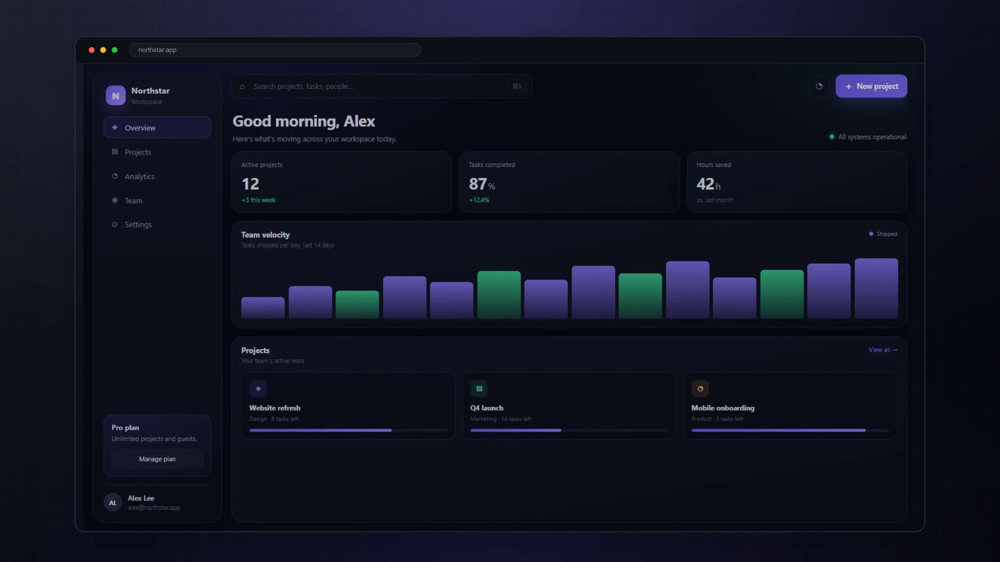
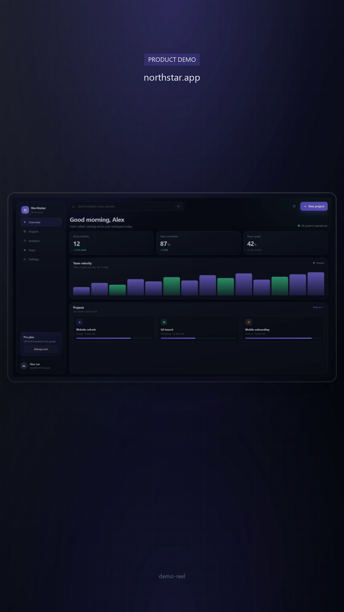

# demo-reel

[](LICENSE)
[](package.json)
[](package.json)
[](SKILL.md)
[](https://github.com/gnawbit/demo-reel/stargazers)

**Give it a URL. Get a polished demo video and GIF.**


[Watch the 12s MP4](docs/hero.mp4) · [Install](#install) · [How it works](#how-it-works) · [Roadmap](#roadmap)

demo-reel is an agent skill that records your product in a real browser, zooms
into every click, adds a cursor, captions, a browser frame and a background,
then renders a launch-ready MP4 + GIF.

No timeline editing. No screen-studio subscription. One command.

> Works with Claude Code, Codex, Cursor and any agent that supports
> [Agent Skills](https://agentskills.io).

---

## Why

Every launch needs a demo:

- a GIF at the top of the README
- a hero video on the landing page
- a clip for X, LinkedIn, Product Hunt
- a walkthrough for onboarding

Recording one by hand takes 1–3 hours and still looks like a screen recording.
demo-reel turns it into a repeatable command. Change the UI, re-run it, get a
fresh demo.

**What you get**

- 1080p MP4 + GIF + poster, in **16:9 and 9:16**
- automatic zoom into each click
- a visible cursor and click ripple
- benefit-driven captions
- a browser frame and a generated background
- a `record.json` timeline you can re-render without recording again
- everything runs locally — no upload, no cloud

### Formats

| 16:9 — README / landing page | 9:16 — Shorts / Reels / 小红书 |
|---|---|
|  |  |

[16:9 MP4](docs/hero.mp4) · [9:16 MP4](docs/hero-9x16.mp4) · [9:16 GIF](docs/hero-9x16.gif)

## Install

As an agent skill:

```bash
npx skills add gnawbit/demo-reel
```

From source:

```bash
git clone https://github.com/gnawbit/demo-reel
cd demo-reel
npm install
npx playwright install chromium
node bin/demo-reel.mjs doctor
```

Requirements: Node 20+. ffmpeg and ffprobe come from npm packages; no system
install needed.

## Quickstart

```bash
# 1. Check the environment
node bin/demo-reel.mjs doctor

# 2. See it work on the bundled demo app
node bin/demo-reel.mjs demo

# 3. Use it on your own app
node bin/demo-reel.mjs plan --url https://your-app.com
node bin/demo-reel.mjs record --config demo.json
node bin/demo-reel.mjs render --config demo/record.json --vertical
```

Output:

```
demo/
  demo-16x9.mp4
  demo-9x16.mp4
  demo.gif
  demo-9x16.gif
  poster.png
  poster-9x16.png
  record.json
```

## The story file

```json
{
  "url": "https://your-app.com",
  "displayUrl": "your-app.com",
  "viewport": { "width": 1440, "height": 810 },
  "brand": { "background": "#070a12", "accent": "#6c5ce7" },
  "steps": [
    { "action": "wait", "ms": 600 },
    {
      "action": "click",
      "text": "New project",
      "pause": 600,
      "zoom": false,
      "caption": "Start in one click"
    },
    { "action": "wait", "ms": 900 },
    {
      "action": "type",
      "selector": "input[name=project-name]",
      "value": "Q4 Launch",
      "pause": 350,
      "caption": "Give it a name"
    },
    { "action": "wait", "ms": 900 },
    {
      "action": "click",
      "text": "Create project",
      "pause": 900,
      "zoom": false,
      "caption": "Your workspace is ready"
    }
  ]
}
```

Actions: `wait`, `goto`, `click`, `type`, `hover`, `drag`, `scroll`, `press`,
`waitFor`, `screenshot`.

Locators, in order of preference:

1. `text` — visible label
2. `role` + `name` — accessible role
3. `selector` — CSS, only when needed

Tips:

- 3–5 steps, 12–25 seconds.
- Add a short `wait` after an action so the result and caption can land.
- Use `"zoom": false` when the interesting result is elsewhere on screen.
- Captions state the benefit, not the UI label.

### Vertical branding

The 9:16 output can carry a custom hook and CTA:

```json
"vertical": {
  "badge": "Your product",
  "titleLines": ["Ship faster", "without the busywork"],
  "subtitle": "Native · Local · Private",
  "cta": "your-app.com",
  "watermark": false
}
```

`titleLines` is capped at two lines. `watermark: false` removes the small
demo-reel mark. Chinese text automatically uses a CJK font.

## Commands

| Command | What it does |
|---|---|
| `demo-reel doctor` | Check Node, Chromium, ffmpeg, fonts |
| `demo-reel plan --url <url>` | Screenshot + list interactive elements |
| `demo-reel record --config demo.json` | Record the story |
| `demo-reel render --config demo/record.json` | Render MP4 + GIF |
| `demo-reel serve` | Serve the bundled demo app |
| `demo-reel demo` | Record + render the bundled demo |

Useful flags:

```bash
--login                 # open a visible browser, log in once
--storage-state auth.json
--proxy http://127.0.0.1:10808
--viewport 1440x810
--headed                # watch the recording happen
--vertical              # also render 9:16 + vertical GIF
--video recording.mp4   # render an existing recording + marks
--no-gif
--no-captions
--zoom 1.28
```

## Login and protected pages

```bash
node bin/demo-reel.mjs record --config demo.json --login
```

A visible browser opens. Log in manually. The session is saved to `auth.json`
locally and reused. demo-reel never asks for your password and never uploads
cookies.

## How it works


1. `plan` opens the page and inventories buttons, links and inputs.
2. `record` drives Chromium, moves the cursor, clicks, types and records.
3. Click timestamps become zoom keyframes.
4. `render` crops around each click, then composes the same timeline into a
   16:9 browser canvas and a 9:16 vertical card, and encodes MP4 + GIF.

Because it drives a real browser, it works with React, Vue, Svelte, plain HTML,
SPAs and authenticated pages.

## Examples

| Example | Story | Output |
|---|---|---|
| Northstar SaaS dashboard | [examples/story.json](examples/story.json) | [16:9 MP4](docs/hero.mp4) · [9:16 MP4](docs/hero-9x16.mp4) · [GIF](docs/hero.gif) |

## Use an existing screen recording

If a site blocks automation, or you are demoing a desktop or mobile app, record
the flow with OBS, Screen Studio, QuickTime or the OS recorder, then describe
where to zoom in `marks`:

```json
{
  "displayUrl": "your-app.com",
  "video": "recording.mp4",
  "marks": [
    {
      "t": 2.1,
      "x": 0.946,
      "y": 0.048,
      "caption": "Start a new project",
      "zoom": false
    },
    {
      "t": 4.1,
      "x": 0.5,
      "y": 0.468,
      "caption": "Give it a name"
    }
  ]
}
```

- `t` is seconds into the recording.
- `x` and `y` are normalized `0..1`; use `zoom: false` to keep the full frame.
- `duration` is the caption hold in seconds (default `0.6`).

```bash
node bin/demo-reel.mjs render \
  --config story-video.json \
  --video recording.mp4 \
  --vertical
```

It produces the same 16:9 and 9:16 videos, GIFs and posters as a URL recording.

A minimal example lives at [examples/story-video.json](examples/story-video.json).

## Why not Screen Studio?

Different tools:

| | Screen Studio | demo-reel |
|---|---|---|
| Workflow | manual editing | a story file + one command |
| Repeatable | no | yes |
| Runs in CI | no | yes |
| Price | paid | free, MIT |

Use Screen Studio when you want frame-by-frame control. Use demo-reel when you
want a repeatable launch asset and a timeline you can commit.

## FAQ

**Is this a screen recorder?**
No. It is a repeatable pipeline: a story file + a browser + a renderer. The
recording is a side effect.

**Does it work on Windows?**
Yes. It is developed on Windows and uses npm-bundled ffmpeg binaries.

**Do I need an AI agent to use it?**
No. The CLI works standalone. The agent skill is a convenience: it can inspect
the page, write the story and run the commands for you.

**Can I record a site I don't own?**
Only with permission. Do not use it to scrape, bypass paywalls or evade
anti-bot systems.

**Do Chinese captions work?**
Yes. demo-reel picks a CJK font automatically: Microsoft YaHei on Windows,
PingFang on macOS, Noto Sans CJK on Linux. `doctor` checks it. If no CJK font is
installed, run `doctor` to see what is missing.

**Can I use the output commercially?**
Yes. The code is MIT. Make sure the page you record and the fonts/assets in it
are yours or licensed.

## Roadmap

- [x] 9:16 vertical export
- [x] Screen-recording input (`--video` + `marks`)
- [ ] Voiceover (TTS)
- [ ] Device frames (iPhone, Android, macOS)
- [ ] Brand presets
- [ ] Cloud rendering

## Contributing

Issues and PRs are welcome. Start with [CONTRIBUTING.md](CONTRIBUTING.md).
Please do not commit `auth.json`, customer recordings or anything that contains
personal data.

## License

MIT — see [LICENSE](LICENSE).

---

If this saved you an afternoon, a star helps more people find it.
