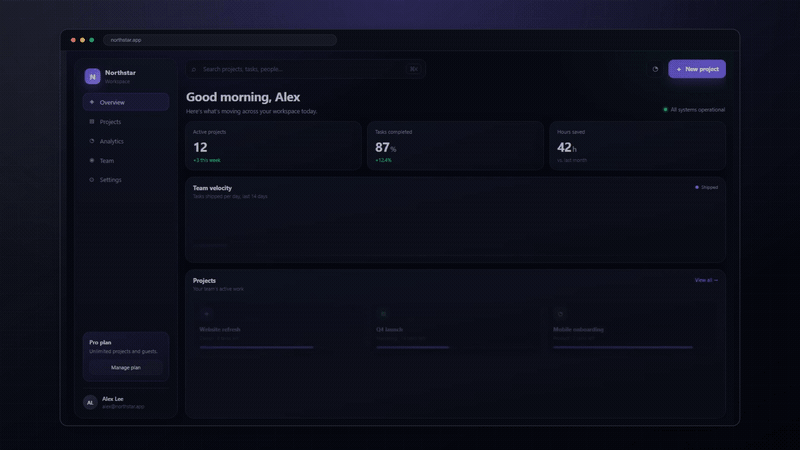

# demo-reel



**给它一个网址，拿回一条能发出去的产品演示视频和 GIF。**

demo-reel 是一个 agent skill：它用真实浏览器打开你的产品，像人一样点击，
自动放大每次点击、加光标、字幕、浏览器边框和背景，最后渲染成 MP4 + GIF。

不用手动剪辑，不用买录屏软件，一条命令。

```
/demo-reel https://your-app.com
```

> 当前版本 v0.1：支持网址输入、16:9 MP4 + GIF。竖屏和“已有录屏输入”在路线图上。

---

## 为什么做这个

每个产品发布都需要一条演示：

- README 顶部的一张 GIF
- 官网 hero 区的一段视频
- 发 X、小红书、Product Hunt 的短片
- 新用户引导里的操作演示

手动录一条要 1–3 小时，而且看起来像“随手录的”。demo-reel 把它变成可重复的命令：
UI 改了，重跑一遍，就是新的 demo。

## 安装

作为 agent skill：

```bash
npx skills add yanjiangfan/demo-reel
```

从源码：

```bash
git clone https://github.com/yanjiangfan/demo-reel
cd demo-reel
npm install
npx playwright install chromium
node bin/demo-reel.mjs doctor
```

要求：Node 20+。ffmpeg/ffprobe 由 npm 包提供，不需要系统安装。

## 快速开始

```bash
# 1. 检查环境
node bin/demo-reel.mjs doctor

# 2. 跑一遍内置 demo
node bin/demo-reel.mjs demo

# 3. 录你自己的产品
node bin/demo-reel.mjs plan --url https://your-app.com
node bin/demo-reel.mjs record --config demo.json
node bin/demo-reel.mjs render --config demo/record.json
```

输出：

```
demo/
  demo-16x9.mp4
  demo.gif
  poster.png
  record.json
```

## 故事文件

```json
{
  "url": "https://your-app.com",
  "viewport": { "width": 1440, "height": 810 },
  "brand": { "background": "#070a12", "accent": "#6c5ce7" },
  "steps": [
    { "action": "wait", "ms": 600 },
    {
      "action": "click",
      "text": "New project",
      "pause": 800,
      "caption": "一键开始"
    },
    {
      "action": "type",
      "selector": "input[name=project-name]",
      "value": "Q4 Launch",
      "pause": 500,
      "caption": "起个名字"
    },
    {
      "action": "click",
      "text": "Create project",
      "pause": 1400,
      "caption": "工作区已就绪"
    }
  ]
}
```

动作：`wait`、`goto`、`click`、`type`、`hover`、`scroll`、`press`、`waitFor`、`screenshot`。

定位元素优先级：

1. `text`：可见文字
2. `role` + `name`：无障碍角色
3. `selector`：CSS，最后才用

## 命令

| 命令 | 作用 |
|---|---|
| `demo-reel doctor` | 检查 Node、Chromium、ffmpeg、字体 |
| `demo-reel plan --url <url>` | 截图 + 列出可交互元素 |
| `demo-reel record --config demo.json` | 录制故事 |
| `demo-reel render --config demo/record.json` | 渲染 MP4 + GIF |
| `demo-reel serve` | 启动内置 demo 站点 |
| `demo-reel demo` | 录制 + 渲染内置 demo |

常用参数：

```bash
--login                 # 打开有头浏览器，手动登录一次
--storage-state auth.json
--proxy http://127.0.0.1:10808
--viewport 1440x810
--headed                # 看着它录
--no-gif
--no-captions
--zoom 1.28
```

## 登录和受保护页面

```bash
node bin/demo-reel.mjs record --config demo.json --login
```

会打开一个有头浏览器，你手动登录，登录态保存在本地 `auth.json`，后续复用。
demo-reel 不会向你要密码，也不会上传 cookie。

## 录不了的站点

有些站点有验证码、强反爬、或纯 Canvas 界面。这种情况下，先手动录屏，
再把录屏作为输入（直接视频输入在路线图上）。不要尝试绕过验证码或反爬。

## 它是怎么工作的

```
SKILL.md                 给 agent 的工作流
scripts/plan.mjs         Playwright：截图 + 元素清单
scripts/record.mjs       Playwright：光标、点击、录屏、事件时间线
scripts/render.mjs       sharp + ffmpeg：背景、边框、缩放、字幕
examples/site/           `demo-reel demo` 用的内置演示站点
```

渲染器会以每次点击为中心裁出 1.28× 的画面，按时间拼接，再把录屏叠到生成的
背景和浏览器边框上。字幕用 ffmpeg `drawtext` 烧录。

## 常见问题

**这是录屏软件吗？**
不是。它是“故事文件 + 浏览器 + 渲染器”的可重复流水线，录屏只是副产物。

**Windows 能用吗？**
能。项目就在 Windows 上开发，ffmpeg 用 npm 包自带二进制。

**必须用 AI agent 吗？**
不必。CLI 可以独立使用；agent skill 只是让它自动读页面、写故事、跑命令。

**能录别人的网站吗？**
只在获得授权时。不要用它抓取、绕过付费墙或规避反爬。

**为什么不直接用 Screen Studio？**
Screen Studio 是手动编辑器；demo-reel 是免费的、MIT 的、可提交到仓库、
可重复执行和自动化的流水线。

## 路线图

- [ ] 9:16 竖屏导出
- [ ] 已有录屏输入（自动缩放 + 字幕）
- [ ] 配音（TTS）
- [ ] 设备边框（iPhone、Android、macOS）
- [ ] 多套品牌预设
- [ ] 云端渲染

## License

MIT
