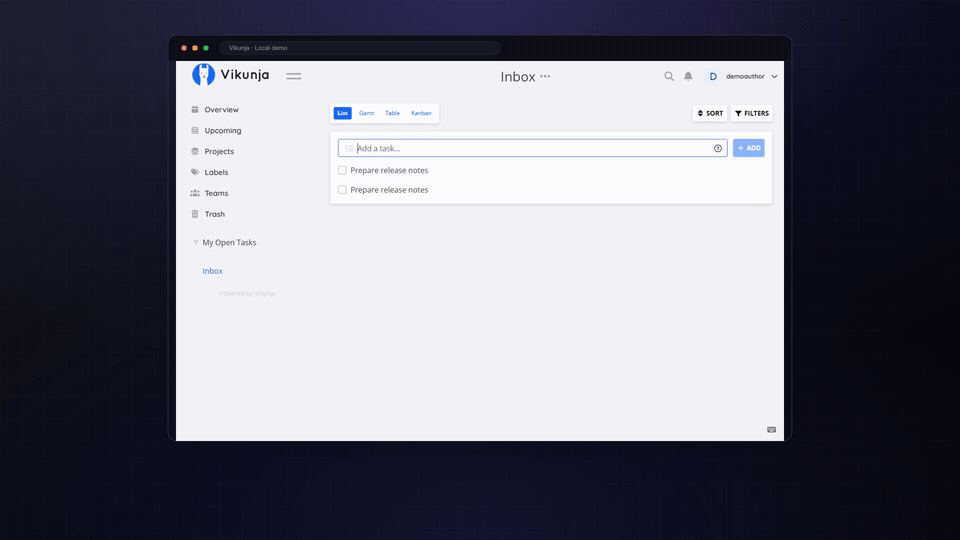
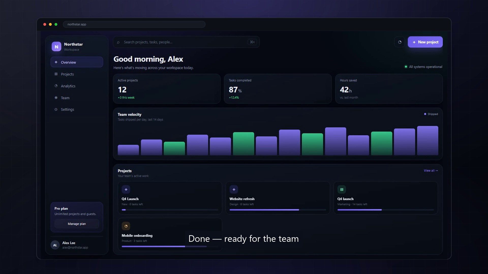
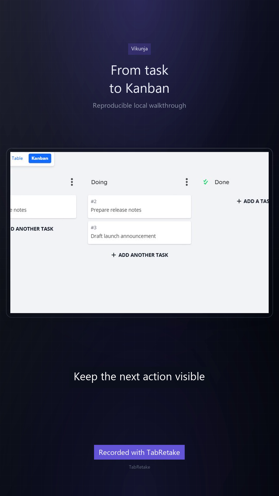
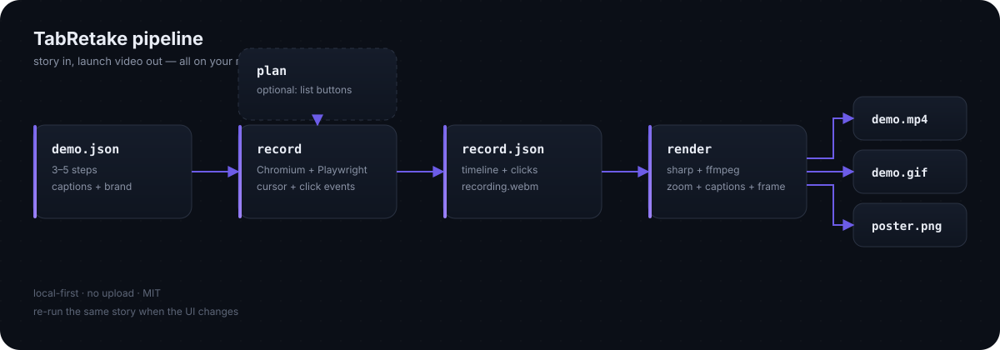

# TabRetake — 可重复生成的 Web 应用演示

[English](README.md) · 简体中文

[](LICENSE)
[](package.json)
[](https://github.com/gnawbit/tabretake/releases/latest)
[](SKILL.md)

**把 Web 应用录成 README 动图或竖屏发布视频。**



[项目页](https://gnawbit.github.io/tabretake/) · [观看演示](docs/hero.mp4) · [安装](#安装) · [工作原理](#工作原理) · [路线图](#路线图)

TabRetake 是在本地生成可重复网页演示的 CLI 和 Agent Skill。用可编辑 JSON
描述操作流程，或让编程助手代写；在 Chromium 中执行步骤，添加点击放大和字幕，
导出横屏或竖屏 MP4、README GIF 和 PNG 封面。支持 Windows、macOS 和 Linux。

故事文件与代码一起保存，界面更新后即可重新生成演示。
已有录屏也可配合时间标记渲染相同产物，无需浏览器自动化；详见[用已有录屏](#用已有录屏)。

[TodoMVC 实例](https://gnawbit.github.io/tabretake/todomvc/)提供固定版本的上游应用、
可下载故事及实测的 README GIF / 9:16 制作流程。

[Agent 发现与调用实测](docs/agent-discovery.md) 分别记录搜索可见性、Skill 选择
和产物成功情况，不将这些测试当作外部采用。

> 支持 Claude Code、Codex、Cursor，以及任何支持
> [Agent Skills](https://agentskills.io) 的 agent。

---

## 为什么做这个

每个产品发布都需要一条演示：

- README 顶部的一张 GIF
- 官网 hero 区的一段视频
- 用于产品发布和社交分享的短片
- 新用户引导里的操作演示

用故事文件记录演示流程，您或编程助手都可以编辑，并在发布新版本后重新生成素材。

**你会得到**

- 1080p MP4 + GIF + 封面，**16:9 和 9:16**
- 每次点击自动放大
- 光标和点击波纹
- 讲收益、不讲按钮名字的字幕
- 浏览器边框和生成的背景
- 可重渲染的 `record.json` 时间线
- 全部在本机完成，不上传、不联网渲染

### 输出格式

| 16:9 — README / 官网 | 9:16 — 竖屏发布短片 |
|---|---|
|  |  |

[16:9 MP4](docs/hero.mp4) · [9:16 MP4](docs/hero-9x16.mp4) · [9:16 GIF](docs/hero-9x16.gif)

## 安装

从 npm 安装 CLI。

```bash
npm install --global @gnawbit/tabretake@0.4.0
tabretake setup
tabretake demo
```

要求 Node 20.9+。可以在工作目录运行 `tabretake`，内置示例会将结果写入
`./demo`。Linux 若缺少浏览器系统依赖，可用 `tabretake setup --with-deps`。
ffmpeg/ffprobe 随依赖安装。

包名为 [`@gnawbit/tabretake`](https://www.npmjs.com/package/@gnawbit/tabretake)，已在 npm 发布。
`v0.3.3` 及更早版本的命令和 Skill 仍叫 `demo-reel`。
安装新版后，现有 JSON 故事可以直接用 `tabretake` 运行。

参与开发时，从源码安装：

```bash
git clone https://github.com/gnawbit/tabretake
cd tabretake
npm ci
node bin/tabretake.mjs setup
node bin/tabretake.mjs doctor
```

以下示例使用源码目录；全局安装后，将 `node bin/tabretake.mjs` 替换为 `tabretake` 即可。

CLI 环境就绪后，可安装 agent 工作流：

```bash
npx skills@1.9.0 add "https://github.com/gnawbit/tabretake.git#v0.4.0" --skill tabretake
```

在目标项目中运行，可加 `--agent codex`、`--agent claude-code` 或 `--agent cursor`
选择客户端。Skills CLI 1.9.0 需要 Node 22.20+，TabRetake 自身需要 Node 20.9+。
将全局 CLI 或源码目录的位置告知编程助手，CLI 和 Skill 应从同一修订版本安装。

Claude Code 也可以通过插件安装（命令行版本需 2.1.292+）：

```bash
claude plugin install tabretake --marketplace "gnawbit/tabretake#v0.4.0"
```

两种工作流安装方式任选其一；插件仍需先安装上述 TabRetake 运行环境。
它是 Claude Code 插件，不是 Cowork 安装包或 MCP 服务。
[发现与调用验证记录](docs/agent-discovery.md)区分了已经验证的能力和尚未测量的效果。
可这样向编程助手提问：

- “把 http://localhost:3000 的注册流程做成 README 动图。”
- “为我的 Web 应用制作带字幕的竖屏发布演示。”
- “界面更新了，按原流程重新生成产品演示。”

编程助手会编写故事并调用 CLI；处理已有录屏时，需要提供视频和要突出的时间点。

## 快速开始

```bash
# 1. 检查环境
node bin/tabretake.mjs doctor

# 2. 跑一遍内置 demo
node bin/tabretake.mjs demo

# 3. 录你自己的产品
node bin/tabretake.mjs plan --url https://your-app.com
node bin/tabretake.mjs init --url https://your-app.com
```

参考 `plan.json` 中的控件，在生成的 `demo.json` 中添加点击、输入等操作。
初始模板只停留在页面上，不会自动编排流程，也不会覆盖已有故事文件。
可用 `--out stories/demo.json` 指定其他路径。

v0.3.3 起，`label` 来自 ARIA 引用或 HTML 标签；原生下拉框的 `options`
包含 `label`、`value` 和 `disabled`，方便识别控件与选项。`name` 仍是 HTML 属性，
`selector` 是建议使用的 CSS 定位器。这是 DOM 清单，不是完整的无障碍树。

```bash
node bin/tabretake.mjs record --config demo.json
node bin/tabretake.mjs render --config demo/record.json --vertical
```

输出：

```
demo/
  demo-16x9.mp4
  demo-9x16.mp4
  demo.gif
  demo-9x16.gif
  poster.png
  poster-9x16.png
  record.json
```

## 故事文件

### 预览与聚焦

录制前运行 `tabretake preview --config demo.json`，可在可见浏览器中执行故事并查看步骤进度。
预览会实际点击和修改应用数据，请使用演示数据并在录制前重置。
已有录制会保留，只有显式 `screenshot` 步骤写出截图。
自动化可加 `--headless --json`，登录后流程可加 `--storage-state auth.json`。

操作后先等待结果出现，再把镜头聚焦到结果元素。
聚焦坐标在目标滚入视口后测量，在 `pause` 期间保持；后续布局变化后可再加一个聚焦步骤。

```json
[
  { "action": "waitFor", "selector": "#result" },
  { "action": "focus", "selector": "#result", "caption": "结果已生成", "pause": 1200 }
]
```

预览检查浏览器操作，缩放和字幕效果需要检查实际渲染成片。

```json
{
  "url": "https://your-app.com",
  "displayUrl": "your-app.com",
  "viewport": { "width": 1440, "height": 810 },
  "brand": { "background": "#070a12", "accent": "#6c5ce7" },
  "steps": [
    { "action": "wait", "ms": 600 },
    {
      "action": "click",
      "text": "New project",
      "pause": 600,
      "zoom": false,
      "caption": "一键开始"
    },
    { "action": "wait", "ms": 900 },
    {
      "action": "type",
      "selector": "input[name=project-name]",
      "value": "Q4 Launch",
      "pause": 350,
      "caption": "起个名字"
    },
    { "action": "wait", "ms": 900 },
    {
      "action": "click",
      "text": "Create project",
      "pause": 900,
      "zoom": false,
      "caption": "工作区已就绪"
    }
  ]
}
```

动作：`wait`、`goto`、`click`、`type`、`hover`、`focus`、`drag`、`scroll`、`press`、`waitFor`、`screenshot`。

v0.3.3 起，`click` 会等待目标启用且不被遮挡。步骤 `timeout`
使用毫秒，默认 20,000；持续阻挡会返回 `STEP_TIMEOUT`。v0.3.2 及更早版本
没有这项可靠的可点击等待。

定位字段为 `selector`、`role` + `name`（或 `text`）、`name` 或 `text`。
显式 `selector` 优先。从 v0.4.0 起，先精确匹配按钮与链接，再部分匹配
按钮与链接，最后尝试普通文字（先精确后部分）。指定 `role` 时只在该角色中匹配，
名称同样先精确后部分。
每个候选取首个可见元素。标签重复或重叠时，使用限定范围的 CSS 选择器。
v0.3.3 及更早版本可能让部分匹配的按钮先于精确匹配的链接：页面同时有
“Clear completed” 按钮时，用 `selector: "a[href='#/completed']"`
代替单独的 `text: "Completed"`。

技巧：

- 3–5 步，12–25 秒。
- 每个动作后加一小段 `wait`，让结果和字幕落地。
- 如果结果在屏幕别处，用 `"zoom": false` 拉回全景。
- 字幕讲收益，不讲“点击按钮”。

字幕会自动换行，并在需要时适度缩小字号。无法保持可读字号时，
渲染会提示缩短文字或拆到多个步骤中；下一条字幕出现时，上一条会立即结束。

### 镜头移动

点击缩放默认用 0.35 秒平滑过渡。在故事或录屏标记配置顶层设置
`"zoomDuration": 0.5`，或用 `render --config demo/record.json --zoom-duration 0.5`
覆盖。设为 `0` 可直接切换；步骤中的 `"zoom": false` 会拉回全景。
连续点击会从当前镜头位置接续。

### 封面

封面默认取接近片尾的一帧，展示操作结果。在故事或录屏标记配置的顶层设置
`"posterAt": 4.5` 可以指定画面；已有时间线可用
`render --config demo/record.json --poster-at 4.5` 覆盖，无需重新录制。
时间从裁剪后成片的第 0 秒开始，必须小于视频时长。

### 竖屏品牌配置

9:16 可以带自定义钩子和 CTA：

```json
"vertical": {
  "badge": "你的产品",
  "titleLines": ["一句话钩子", "第二行补充"],
  "subtitle": "Windows 原生 · 本地处理",
  "cta": "your-app.com",
  "watermark": false
}
```

`titleLines` 最多两行；`watermark: false` 会去掉底部的小 TabRetake 水印。
中文会自动用 CJK 字体。

v0.3.2 起，竖屏卡片按源视频比例适配。移动端流程可先用
`plan --viewport 390x844` 检查布局，再用相同 viewport 录制。
渲染时加 `--vertical --zoom 1` 保留完整视口；更大的缩放会围绕焦点裁切。
宽屏桌面录屏中的细字仍可能偏小。

## 命令

| 命令 | 作用 |
|---|---|
| `tabretake --version` | 输出已安装 CLI 的版本 |
| `tabretake capabilities --json` | 查询支持的命令、参数及 JSON 输出 |
| `tabretake doctor [--json]` | 检查 Node、Chromium、ffmpeg、字体 |
| `tabretake setup` | 安装与当前 CLI 匹配的 Chromium |
| `tabretake init --url <url>` | 创建可编辑的故事文件 |
| `tabretake validate --config demo.json [--json]` | 预检故事、录屏标记或录制时间线 |
| `tabretake plan --url <url>` | 截图 + 列出可交互元素 |
| `tabretake record --config demo.json` | 录制故事 |
| `tabretake preview --config demo.json` | 在可见浏览器中执行步骤，提前检查故事 |
| `tabretake render --config demo/record.json` | 渲染 MP4 + GIF |
| `tabretake serve` | 启动内置 demo 站点 |
| `tabretake demo` | 录制 + 渲染内置 demo |

Agent 可用 `capabilities --json` 和 `doctor --json` 获取标准输出上的单个 JSON
对象，包含 `schemaVersion: 1` 和已安装版本。诊断包含稳定的 `id`、`required`、
`status`，失败时提供修复提示 `hint`。必需检查失败返回退出码 `1`；缺少字体仅警告，
必需项通过时退出码仍为 `0`。Chromium 仅检查是否安装，不实际启动。
JSON 工作流及配置校验需要 v0.3.0 或更新版本。

`doctor` 检查整个工具链。渲染现有录屏或已保存的时间线不需要 Chromium；
若唯一失败的必需项是 `chromium`，可跳过浏览器安装，继续 `validate` 和
`render`，其他必需项错误仍需先修复。网页规划和录制仍需要 Chromium。

录制前运行 `validate --config demo.json --json`，按随包提供的
[JSON Schema](schemas/story.schema.json) 检查类型、动作、必需目标和未知字段。
失败返回退出码 `1`，错误包含 `code`、JSON Pointer 路径 `path`（如
`/steps/0/action`）、`message` 和 `hint`；JSON 语法或文件读取错误使用 `error` 对象。
预检不会启动浏览器，也不验证选择器、登录态或媒体文件是否可用。
`record` 和 `render` 也会在改写输出文件前校验输入。编辑器补全可在配置中加入
`"$schema": "https://raw.githubusercontent.com/gnawbit/tabretake/main/schemas/story.schema.json"`。

常用参数：

`init`、`plan`、`record`、`render` 也支持 `--json`：标准输出只有一个结果对象，
进度写入标准错误。成功结果包含 `command`、`ok`、`version`、`schemaVersion`，
以及列出绝对路径、类型、字节数的 `artifacts`。步骤失败提供从零开始的
`error.step.index`、动作、JSON Pointer 路径及修复提示，修正后再重试。
手动 `--login` 需在交互终端运行且不带 `--json`，自动调用使用 `--storage-state`。
失败可能留下部分文件；应以本次成功结果的产物清单确认输出。

v0.3.1 起将页面导航失败报告为 `PAGE_UNREACHABLE`，提示检查
URL、服务和网络；HTTP 4xx/5xx 返回 `PAGE_HTTP_ERROR` 与 `error.status`，
避免把错误页录成成功演示。这类错误不回显目标 URL 中的凭据或查询参数。
`doctor` 只检查依赖，不能证明目标应用可访问。

v0.3.2 起，手动 `--login` 的导航异常也不回显目标 URL；HTTP 401/403
页面会保留供登录，其他 HTTP 错误会停止命令。

v0.3.1 起已修正字幕时序：动作完成即显示字幕，随后 `pause` 留出阅读时间。
v0.3.0 可用 `pause: 0` 加独立 `wait` 步骤代替。旧时间线需重新录制才能获得
新时序，仅重新渲染会保留原时间戳。

```bash
--login                 # 打开有头浏览器，手动登录一次
--storage-state auth.json
--proxy http://127.0.0.1:10808
--viewport 1440x810
--headed                # 看着它录
--vertical              # 同时输出 9:16 和竖屏 GIF
--video recording.mp4   # 渲染已有录屏 + marks
--no-gif
--no-captions
--zoom 1.28
```

## 登录和受保护页面

```bash
node bin/tabretake.mjs record --config demo.json --login
```

请在可交互终端运行。浏览器打开后手动登录，登录态保存在本地 `auth.json`，
供本次录制使用。后续运行，或先用 `plan --login` 登录后，必须显式传入：

```bash
node bin/tabretake.mjs record --config demo.json --storage-state auth.json
```

切换工作目录时请使用登录态文件的绝对路径。TabRetake 不会向你要密码，也不会
上传 cookie。不要将登录态提交到 Git。

## 工作原理



1. `plan` 打开页面，列出按钮、链接和输入框。
2. `record` 驱动 Chromium，移动光标、点击、输入、录屏。
3. 点击时间戳变成缩放关键帧。
4. `render` 裁出点击区域，把同一条时间线分别合成到 16:9 浏览器画布和 9:16 竖屏卡片，再用 ffmpeg 编码。

因为驱动的是真实浏览器，React、Vue、Svelte、纯 HTML、SPA 和登录后的页面都能录。

## 示例

真实开源应用案例包括 [Vikunja](https://gnawbit.github.io/tabretake/vikunja/) 的任务创建与看板拖拽，
以及 [Memos](https://gnawbit.github.io/tabretake/memos/) 的富文本笔记与搜索。
案例固定上游原版发行包，提供故事下载、本机搭建和重复录制方法。

[手动演示工作流](.github/workflows/demo.yml) 会启动固定版本的 TodoMVC、等待服务就绪、
录制故事并上传 MP4、GIF 和封面附件。在自己的 fork 中选择
**Actions → Regenerate TodoMVC demo → Run workflow** 即可运行。
接入自己的应用时，替换应用检出与启动命令、就绪检测地址和故事文件。
使用可重置的演示数据，并在发布前检查成片。

| 示例 | 故事 | 输出 |
|---|---|---|
| Northstar SaaS dashboard | [examples/story.json](examples/story.json) | [16:9 MP4](docs/hero.mp4) · [9:16 MP4](docs/hero-9x16.mp4) · [GIF](docs/hero.gif) |

Northstar 是内置的虚构应用。三个[可运行示例](examples/README.md)分别展示
README 动图、首次创建项目，以及重复生成发布素材。从源码目录运行（全局安装可将前缀替换为 `tabretake`）：

```bash
node bin/tabretake.mjs demo --story readme --port 0 --out demo-readme
node bin/tabretake.mjs demo --story onboarding --port 0 --out demo-onboarding
node bin/tabretake.mjs demo --story release --port 0 --out demo-release
```

## 用已有录屏

如果站点有验证码、强反爬，或者你要演示的是桌面 App / 手机 App，先用 OBS、
Screen Studio、QuickTime 或系统录屏录下来，再用 `marks` 描述哪里该放大：

```json
{
  "displayUrl": "your-app.com",
  "video": "recording.mp4",
  "marks": [
    {
      "t": 2.1,
      "x": 0.946,
      "y": 0.048,
      "caption": "一键开始",
      "zoom": false
    },
    {
      "t": 4.1,
      "x": 0.5,
      "y": 0.468,
      "caption": "起个名字"
    }
  ]
}
```

- `t`：录屏里的秒数
- `x` / `y`：归一化 `0..1`；`zoom: false` 表示这一步保持全景
- `duration`：字幕相对 `t` 的出现延迟，单位为秒，默认 `0.6`；设为 `0` 即在标记处出现，不是字幕停留时间。
- 字幕最多显示 2.8 秒；下一条字幕出现或视频结束时会提前结束。

```bash
node bin/tabretake.mjs render \
  --config story-video.json \
  --video recording.mp4 \
  --vertical
```

输出和网址录制完全一样：16:9 / 9:16 视频、GIF、封面。

最小示例见 [examples/story-video.json](examples/story-video.json)。

## 和 Screen Studio 的区别

| | Screen Studio | TabRetake |
|---|---|---|
| 工作流 | 手动剪辑 | 故事文件 + 一条命令 |
| 可重复 | 否 | 是 |
| 能进 CI | 否 | 是 |
| 价格 | 付费 | 免费，MIT |

要逐帧精修，用 Screen Studio；要可重复、可提交、可自动化的发布素材，用 TabRetake。

## 常见问题

**这是录屏软件吗？**
不是。它是“故事文件 + 浏览器 + 渲染器”的可重复流水线，录屏只是副产物。

**Windows 能用吗？**
能。项目就在 Windows 上开发，ffmpeg 用 npm 包自带二进制。

**必须用 AI agent 吗？**
不必。CLI 可以独立使用；agent skill 只是让它自动读页面、写故事、跑命令。

**能录别人的网站吗？**
只在获得授权时。不要用它抓取、绕过付费墙或规避反爬。

**中文字幕能正常显示吗？**
能。TabRetake 会自动选 CJK 字体：Windows 用微软雅黑，macOS 用苹方，
Linux 用 Noto Sans CJK。`doctor` 会检查。

**输出可以商用吗？**
可以。代码是 MIT。确保你录的页面、字体和素材是你自己的或已授权。

## 路线图

- [x] 9:16 竖屏导出
- [x] 已有录屏输入（`--video` + `marks`）
- [ ] 配音（TTS）
- [ ] 设备边框（iPhone、Android、macOS）
- [ ] 多套品牌预设
- [ ] 云端渲染

## 参与贡献

欢迎 issue 和 PR，先看 [CONTRIBUTING.md](CONTRIBUTING.md)。
请不要提交 `auth.json`、客户录屏或任何包含个人数据的文件。

## License

MIT — 见 [LICENSE](LICENSE)。

---

如果它帮你省下了一个下午，点个 star 能让更多人看到。
