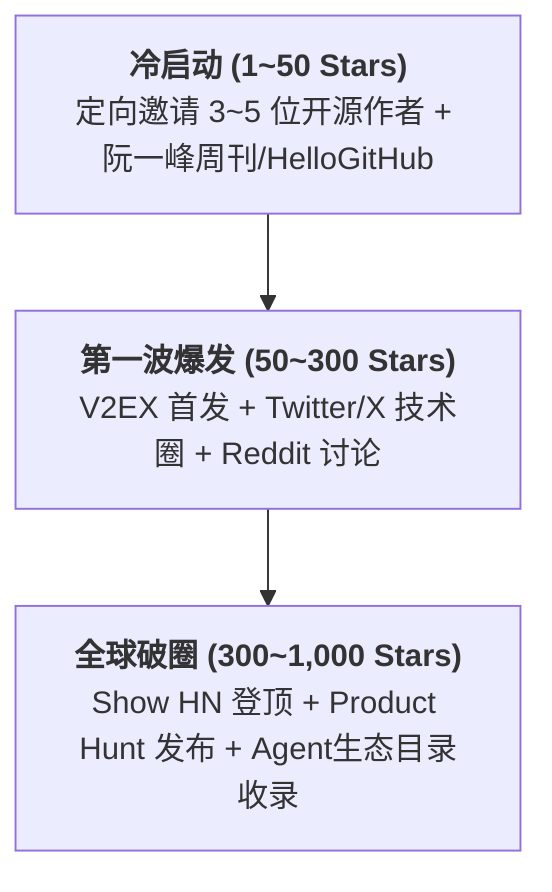

# TabRetake 全渠道推广与种子用户获取操作手册 (Distribution Playbook)

本手册专为 TabRetake 达成 **GitHub 1,000 Stars** 阶段性目标制定。遵循客观、高质量、尊重开源社区规范的原则，杜绝无意义的垃圾推广，通过**解决真实痛点**与**真实案例成片**吸引开源开发者与技术创作者。

---

## 目录

1. [渠道矩阵与节奏规划](#一渠道矩阵与节奏规划)
2. [国内核心开发者社区发布文案](#二国内核心开发者社区发布文案)
   - [V2EX（程序员 / 开源软件节点）](#1-v2ex程序员--开源软件节点)
   - [阮一峰《科技爱好者周刊》投稿](#2-阮一峰科技爱好者周刊投稿)
   - [HelloGitHub 开源月刊推荐投稿](#3-hellogithub-开源月刊推荐投稿)
3. [海外顶级技术生态发布文案](#三海外顶级技术生态发布文案)
   - [Show HN (Hacker News)](#1-show-hn-hacker-news)
   - [Twitter / X 官方发布 Thread](#2-twitter--x-发布-thread)
   - [Reddit (r/webdev, r/opensource)](#3-reddit-rwebdev-rospensource)
4. [真实开源项目定向邀请与协作规范](#四真实开源项目定向邀请与协作规范)
   - [如何合法合规联系开源项目维护者](#1-联系原则严禁在-issue-提推广垃圾)
   - [为 Vikunja 维护者量身定制的邀请信](#2-vikunja-定向邀请草稿)
   - [为 Memos 维护者量身定制的邀请信](#3-memos-定向邀请草稿)
5. [转化指标追踪与自检清单](#五转化指标追踪与自检清单)

---

## 一、 渠道矩阵与节奏规划



| 推进批次 | 推荐渠道 | 核心诉求 | 预期增益 |
|---|---|---|---|
| **第一批（立即执行）** | 阮一峰周刊、HelloGitHub、V2EX | 验证国内开发者需求、沉淀首批中文反馈与 Star 基底 | +100 ~ 300 Stars |
| **第二批（3天内）** | Show HN、Twitter/X 技术 Thread、Reddit | 触达欧美极客与 AI Coding Agent（Claude Code/Cursor）核心圈 | +200 ~ 500 Stars |
| **第三批（10天内）** | Product Hunt、开源项目 README 友情反哺 Badge | 建立长期自然搜索流量与 GitHub Trending 上榜机会 | +500 ~ 1,000 Stars |

---

## 二、 国内核心开发者社区发布文案

### 1. V2EX（程序员 / 开源软件节点）

- **建议节点**：`分享创造` 或 `程序员`
- **标题**：`受够了每次功能改版手动录屏剪辑？做了一个本地可重拍 Web 演示生成器 TabRetake`
- **正文草稿**：

```markdown
各位 V 友大家好，

每次发新版本或者写开源项目 README 时，总少不了一条直观的功能演示动图或视频。但传统的手动录屏流程非常痛苦：
1. **界面一改就报废**：改了个按钮样式或文案，之前的录屏和剪辑全废了，得重录一遍；
2. **手机端展示尴尬**：把桌面浏览器录屏放到 9:16 竖屏（小红书/推特/短视频）上，字小得根本看不清；
3. **字幕遮挡操作**：手动剪辑加的字幕悬浮在界面上，经常挡住正在输入的文本框或按钮；
4. **无法自动化**：每次发版都是纯人工重复劳动。

为了解决这个问题，我写了一个完全在本地运行的开源 CLI 与 AI Agent 技能：**TabRetake**。

- 仓库地址：https://github.com/gnawbit/tabretake
- 协议：MIT (纯本地运行，Playwright + FFmpeg + Sharp，无云端依赖，无数据上传)

### 它是怎么工作的？
就像写自动化测试一样，你只需用几行可编辑的 JSON 描述操作流程（或者让 Claude Code / Cursor / Codex 代写），TabRetake 会自动启动 Chromium 执行、在点击时平滑推进放大镜头、添加光标波纹，并自动生成：
- **16:9 README GIF / MP4**（按源比例适配留白，字幕固定居于内容下方，绝不遮挡操作）；
- **9:16 竖屏发布短视频**（支持独立的局部缩放倍率，小字也能看清）；
- **结果聚焦高清封面**。

下次界面改版？改动 1 行 JSON，一条命令 10 秒自动重拍重渲染。

### 拒绝 AI 假模版：实测在真实开源项目上的效果
工具到底能不能用，最怕看假 demo。我们在几个真实开源项目上进行了端到端实测：
- **Vikunja 看板拖拽 (15k★)**：演示在真实看板上将任务跨列拖入 Doing，并自动聚焦到目标卡片（成片 GIF 仅 424 KB，加载极快）：
  https://raw.githubusercontent.com/gnawbit/tabretake/main/docs/hero.gif
- **Memos 知识笔记 (35k★)**：演示真实 contenteditable 富文本输入与搜索高亮结果拉近（成片 GIF 仅 836 KB）：
  https://raw.githubusercontent.com/gnawbit/tabretake/main/docs/examples/memos.gif
- **TodoMVC (经典前端标准)**：演示多状态任务过滤（成片 GIF 仅 908 KB）。

### 极速上手体验（30秒）
```bash
npm install --global @gnawbit/tabretake@0.5.0
tabretake demo --preset daylight
```

如果你在用 Claude Code，也可以直接装插件：
```bash
claude plugin install tabretake --marketplace "gnawbit/tabretake#v0.5.0"
```
对它说一句：“为 http://localhost:3000 的注册流程生成一张带点击放大的 README 动图”，它就会帮你写步骤并全自动跑出成片。

目前刚刚发布了 v0.5.0，支持浏览器交互式直接捕获生成 `story.json`（`capture`）、本地点击视频自动打点（`mark`）、一条命令闭环出片（`run`）与 2x HiDPI 高清放大，很想听听大家对于“Web 演示可重复生成”这一工作流的看法与建议，欢迎吐槽或提 Issue！如果觉得对你有帮助，求一个 Star 支持～🌟
```

---

### 2. 阮一峰《科技爱好者周刊》投稿

- **投稿地址**：在 [ruanyf/weekly](https://github.com/ruanyf/weekly/issues) 提交 Issue。
- **Issue 标题**：`开源项目推荐：TabRetake —— 可重复生成的 Web 应用演示与 README 动图生成器`
- **Issue 内容草稿**：

```markdown
## 项目名称
TabRetake

## 项目地址
https://github.com/gnawbit/tabretake

## 项目简介
每个 Web 项目发版都需要演示素材，但手动录屏不仅费时，且一旦界面微调就需全部重录。

TabRetake 是一个本地、声明式的 Web 演示视频与 README 动图生成工具（同时也是 Claude Code / Cursor / Codex 的 Agent Skill）。开发者只需用 JSON 描述步骤，或让 AI 编程助手代写，工具便会在本地 Chromium 中自动执行流程、平滑放大点击区域、添加光标波纹与居底字幕，并同时导出 16:9 动图/视频与 9:16 竖屏短片。当产品界面改版时，只需一条命令即可重新生成全套最新演示。

## 核心亮点
1. **真实可复现**：非 AI 假概念，已实测支持 Vikunja（看板拖拽）、Memos（富文本编辑）与 TodoMVC；
2. **画面居底自适应**：按源视频比例自适应留白，字幕固定位于画面下方，绝不遮挡操作交互；
3. **极佳压缩比**：真实 10 秒看板全流程生成的 README GIF 仅 424 KB，秒开无卡顿；
4. **完全本地运行**：基于 Playwright、FFmpeg 与 Sharp，不依赖云端，不上传任何代码与私有数据。

## 演示动图

```

---

### 3. HelloGitHub 开源月刊推荐投稿

- **投稿地址**：在 [521xueweihan/HelloGitHub](https://github.com/521xueweihan/HelloGitHub/issues) 提交 Issue。
- **Issue 内容草稿**：

```markdown
- 项目名称：TabRetake
- 项目地址：https://github.com/gnawbit/tabretake
- 类别：JavaScript / 开发者工具
- 一句话描述：可重复生成的 Web 应用演示视频与 README 动图生成工具
- 项目推荐语：
每次产品改版都要重新录屏做 README 动图？TabRetake 把演示流程变成了“可编辑的代码”。你可以用 JSON 描述点击、输入和拖拽步骤（或让 AI 助手一句话代写），在本地自动跑出带点击自动放大、光标波纹和居底字幕的 16:9 README GIF 以及 9:16 手机短视频。改版后无需重新剪辑，一行命令秒级重新录制渲染。项目完全基于本地 Playwright 和 FFmpeg 运行，生成出的动图体积非常克制（真实项目动图仅约 400KB）。
- 效果展示：
https://raw.githubusercontent.com/gnawbit/tabretake/main/docs/hero.gif
```

---

## 三、 海外顶级技术生态发布文案

### 1. Show HN (Hacker News)

- **标题**：`Show HN: TabRetake – Repeatable README GIFs and 9:16 demo videos from Playwright/AI Agents`
- **链接**：`https://github.com/gnawbit/tabretake`
- **正文**：

```markdown
Hi HN,

I built TabRetake because I was tired of manually recording screen demos for releases, only to have them ruined and obsolete the moment a button label or CSS margin changed.

TabRetake is a local CLI and Agent Skill that turns editable JSON steps (or conversational prompts to Claude Code/Cursor) into crisp, reproducible product walkthroughs:
- 16:9 README GIFs and MP4s with automatic easing zooms into clicks and click ripples.
- 9:16 vertical videos with independent zoom magnification so desktop text remains legible on mobile.
- Dedicated bottom caption bands that never occlude the UI elements being clicked.
- Purely local execution via Chromium (Playwright), FFmpeg, and Sharp. No cloud, no telemetry, no subscription.

When your UI updates, you don't spend an hour re-recording and editing in Screen Studio or Premiere. You update 1 line in your story JSON and run `tabretake render`.

### Tested on Real Open-Source Projects (Not AI Mockups)
Instead of synthetic marketing templates, we verified TabRetake against complex real-world open-source apps:
- Vikunja (15k★ Go/Vue Kanban): types a task, drags it across columns into Doing, and pulls focus to the moved card (424 KB GIF): https://raw.githubusercontent.com/gnawbit/tabretake/main/docs/hero.gif
- Memos (35k★ Notes): contenteditable rich-text writing, tag interaction and search highlighting (836 KB GIF).
- TodoMVC: classic multi-state task filtering (908 KB GIF).

Try it in 30 seconds:
```bash
npm install --global @gnawbit/tabretake@0.5.0
tabretake demo --preset daylight
```

Code & docs: https://github.com/gnawbit/tabretake (MIT)

Would love your feedback on the JSON story format and camera easing mechanics!
```

---

### 2. Twitter / X 发布 Thread

- **Tweet 1 (主推文 + 视频/GIF)**：
  > Stop manually recording & editing product demos every time your UI changes.
  > 
  > Introducing TabRetake: Turn editable JSON steps (or AI Agent prompts) into crisp README GIFs and 9:16 launch videos with smooth click-zooms & bottom captions.
  > 
  > 🧵 1/4 👇
  > *(附带 docs/hero.mp4 视频)*

- **Tweet 2 (核心痛点解决)**：
  > ⚡ Traditional screen recording:
  > • UI tweaks = 2 hours re-recording
  > • Subtitles occlude buttons
  > • Mobile 9:16 requires separate crops
  > 
  > ⚡ With TabRetake:
  > • Change 1 line of JSON $\to$ re-rendered in 10s
  > • Captions placed cleanly below content
  > • Simultaneous 16:9 + 9:16 output
  > 
  > 2/4

- **Tweet 3 (真实开源项目实测)**：
  > No synthetic AI mockups.
  > 
  > TabRetake is verified on real-world OSS:
  > • Vikunja (@go_vikunja): Live Kanban drag-and-drop
  > • Memos (@usememos): Rich-text & instant search
  > • TodoMVC: Full state filtering
  > 
  > A 10s full-flow GIF is only 424 KB!
  > 
  > 3/4

- **Tweet 4 (CTA 与链接)**：
  > Completely local & open source (MIT).
  > Built with Playwright + FFmpeg.
  > 
  > Works with Claude Code, Cursor, and any Agent Skill client.
  > 
  > 📦 `npm i -g @gnawbit/tabretake`
  > ⭐ Star on GitHub: https://github.com/gnawbit/tabretake
  > 
  > 4/4 🚀

---

## 四、 真实开源项目定向邀请与协作规范

### 1. 联系原则（严禁在 Issue 提推广垃圾）

> [!CAUTION]
> **开源礼仪第一准则**
> - **绝对禁止**在目标开源项目的 GitHub Issue 或 Discussions 发布任何未被邀请的营销推广；
> - 仅通过 **Twitter/X 私信**、**开源项目公开 Discord/Slack 社区的 #showcase 频道**，或在对方主动寻找 README 动图方案时提供帮助；
> - 核心出发点是：**“我免费帮你们做了一张超轻量、丝滑的 README 动图，脚本已写好，你们如果觉得好用可以直接拿走”**。

---

### 2. Vikunja 定向邀请草稿

- **联系渠道**：Vikunja 官方论坛/Discord `#general` 或 Twitter 提及 `@go_vikunja`
- **英文草稿**：

```text
Hi @go_vikunja team! Huge fan of Vikunja.

I noticed many users love seeing the Kanban workflow in action before installing. I used our open-source tool (TabRetake) to record a reproducible 9-second walkthrough of creating a task and dragging it across the Vikunja Kanban board:

• 16:9 GIF (only 424 KB!): https://raw.githubusercontent.com/gnawbit/tabretake/main/docs/hero.gif
• 9:16 Mobile Short: https://raw.githubusercontent.com/gnawbit/tabretake/main/docs/hero-9x16.mp4
• Fully reproducible story JSON: https://github.com/gnawbit/tabretake/blob/main/site/vikunja/story.json

Feel free to use the GIF/video directly in your README or docs if you find it helpful! No attribution required. If you ever want any timing or text adjusted, I'd be thrilled to re-run it for you!
```

---

### 3. Memos 定向邀请草稿

- **联系渠道**：Memos Discord `#showcase` 或 GitHub 社区交流群
- **英文草稿**：

```text
Hey @usememos contributors!

We love Memos' clean UI and speed. To show off how snappy rich-text authoring and instant search are, we generated a repeatable, lightweight demo video using your official v26.11 release:

• Lightweight GIF (836 KB): https://raw.githubusercontent.com/gnawbit/tabretake/main/docs/examples/memos.gif
• Story file: https://github.com/gnawbit/tabretake/blob/main/site/memos/story.json

You're completely welcome to drop the GIF into your README if you'd like a live animation of Memos in action. Thanks for building such an awesome tool!
```

---

## 五、 转化指标追踪与自检清单

每次发布推广或邀请后，运行维护者指标收集工具记录数据变化：

```bash
node tools/collect-metrics.mjs --traffic --out evals/weekly/YYYY-MM-DD.json
```

- [ ] **周度流量关注**：观察 Unique Referrers 是否出现 `v2ex.com`、`news.ycombinator.com`、`t.co` 或 `github.com/trending`。
- [ ] **转化率测算**：访客数 (UV) $\to$ Star 转化率通常在 5%~15% 属于高转化区间。若浏览量高但 Star 转化低，根据反馈微调首屏文案。
- [ ] **外部采用标记**：一旦有外部项目在 README 采纳了 TabRetake 生成的 GIF 或给予了 Star，立即记录在 `docs/adoption.md` 中作为真实背书。
